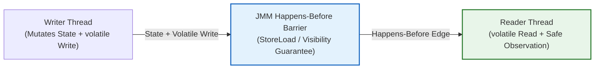

# 01: Java Memory Model (JMM) & Visibility

## Architectural Overview

On modern multi-core CPUs with out-of-order execution, store buffers, and per-core caches, concurrent memory operations do not automatically become globally visible or ordered across threads without explicit synchronization or memory barriers:

- **Unsafe Publication & Data Race Anti-Pattern:** Reading or writing shared state across threads without `volatile`, `synchronized`, `final` safe publication, or `java.util.concurrent` happens-before guarantees allows instruction reordering, stale cached reads, or torn object observations.
- **JMM Happens-Before & Memory Barriers:** Uses `volatile` read/write barriers, `final` field freezing, and ordered synchronization primitives to establish clear happens-before edges and predictable cross-thread visibility.



---

## Key Trade-offs

| Dimension | Unsynchronized / Plain Shared Fields | `volatile` / Happens-Before Synchronization |
| :--- | :--- | :--- |
| **Visibility & Ordering** | Susceptible to reordering & stale thread caches | Guarantees happens-before visibility & ordering |
| **Compound Mutations** | Not atomic for check-then-act or read-modify-write | Still requires locking or atomic CAS for compound updates |
| **Overhead** | Minimal instruction overhead | Introduces barrier/ordering constraints on hot paths |

---

## Build & Run

```bash
mvn test -f 01-java-internals-mastery/01-memory-model/pom.xml -Dnet.bytebuddy.experimental=true
```
