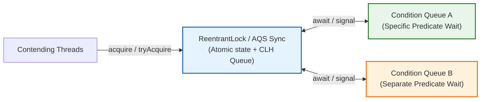

# 02: Locks & AbstractQueuedSynchronizer (AQS)

## Architectural Overview

Coordinating exclusive access, condition signaling, and queued contention in Java relies on `AbstractQueuedSynchronizer` (AQS) and explicit lock/condition abstractions rather than uncoordinated monitor blocks:

- **Ad-Hoc Monitor / Unbounded Contention Anti-Pattern:** Relying solely on implicit monitors without fairness/condition separation or timed/interruptible acquisition can cause thundering-herd wakeups or difficult lock diagnostics.
- **Explicit Locks, Condition Queues & AQS State:** Uses `ReentrantLock`, dedicated `Condition` wait sets, and AQS `state` management to separate waiting conditions, support fair/non-fair modes, and control thread parking cleanly.



---

## Key Trade-offs

| Dimension | Intrinsic `synchronized` Monitor | `ReentrantLock` + `Condition` / AQS |
| :--- | :--- | :--- |
| **Condition Signaling** | Single wait-set per monitor | Multiple targeted `Condition` queues per lock |
| **Acquisition Control** | Uninterruptible / no timed `tryLock` | Supports `tryLock(timeout)`, interruptibility & fairness policy |
| **Syntax & Boilerplate** | Concise block/method syntax | Requires explicit `try / finally` unlock discipline |

---

## Build & Run

```bash
mvn test -f 01-java-internals-mastery/02-locks-and-aqs/pom.xml -Dnet.bytebuddy.experimental=true
```
