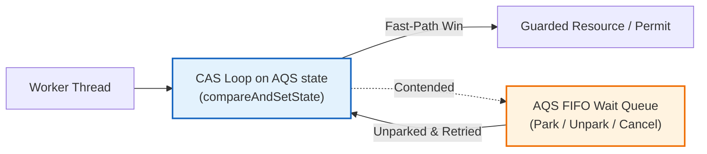

# 03: AQS Internals & Custom Synchronizers

## Architectural Overview

Building custom latches, semaphores, or bounded synchronizers on top of `AbstractQueuedSynchronizer` requires careful coordination between atomic `state` transitions and the FIFO wait queue:

- **Broken Spin / Ad-Hoc Wait-Queue Anti-Pattern:** Hand-rolling custom wait lists or spinning without backoff/parking wastes CPU cycles, risks lost wakeups, or violates memory ordering.
- **AQS FIFO Queue & CAS State Loops:** Delegates queue management, node parking/unparking, and cancellation handling to AQS while implementing clean `tryAcquire`/`tryRelease` (or shared-mode) CAS transitions on `state`.



---

## Key Trade-offs

| Dimension | Custom Ad-Hoc Synchronizer / Spin Loop | AQS-Backed Synchronizer (`state` + FIFO Queue) |
| :--- | :--- | :--- |
| **Queue & Wakeup Correctness** | High risk of race bugs, lost signals & spin burn | Battle-tested FIFO queuing, park/unpark & cancellation |
| **Flexibility** | Tailored to a single bespoke pattern | Supports exclusive (`tryAcquire`) and shared (`tryAcquireShared`) modes |
| **Implementation Complexity** | Deceptively tricky under concurrency stress | Requires clear `state` invariants & mode semantics |

---

## Build & Run

```bash
mvn test -f 01-java-internals-mastery/03-aqs-internals/pom.xml -Dnet.bytebuddy.experimental=true
```
