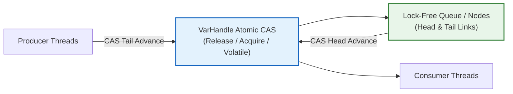

# 04: Lock-Free Primitives & `VarHandle`

## Architectural Overview

High-concurrency queues and shared structures can avoid coarse lock contention by coordinating atomic pointer/state updates with `VarHandle` compare-and-set (CAS) and explicit memory modes:

- **Coarse Lock Contention Anti-Pattern:** Serializing every enqueue/dequeue behind a single lock creates contention bottlenecks and thread blocking under heavy multi-producer/consumer load.
- **Lock-Free CAS & `VarHandle` Access Modes:** Uses `VarHandle` (`compareAndSet`, `getAcquire`, `setRelease`, `getVolatile`) to advance head/tail/node links non-blockingly with well-defined memory ordering.



---

## Key Trade-offs

| Dimension | Lock-Based Queue / Structure | Lock-Free `VarHandle` CAS Structure |
| :--- | :--- | :--- |
| **Thread Blocking & Contention** | Threads block when lock is held | Non-blocking CAS progress; retries under contention |
| **Ordering Granularity** | Full lock critical section | Fine-grained `VarHandle` access modes (`plain`, `opaque`, `releaseAcquire`, `volatile`) |
| **Design & Verification Effort** | Easier to reason about invariants | Requires careful CAS retry loops, ABA/null-link & edge-case testing |

---

## Build & Run

```bash
mvn test -f 01-java-internals-mastery/04-lock-free-primitives/pom.xml -Dnet.bytebuddy.experimental=true
```
