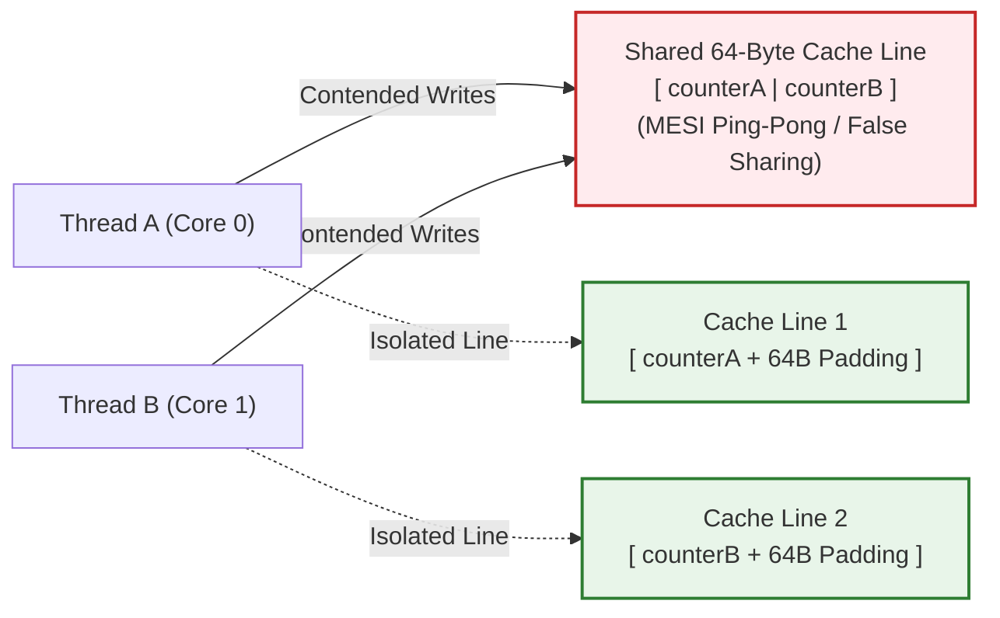

# Day 05: False Sharing & Cache-Line Padding

## Architectural Overview

On multi-core CPUs, memory coherency (MESI/MOESI) operates at the **cache-line granularity** (typically **64 bytes**), not at the individual field or primitive level:

- **False Sharing Anti-Pattern:** Two or more independent counters/fields mutated concurrently by different threads sit on the same 64-byte cache line. Even though threads write to distinct variables, cache-line invalidation bounces ownership across cores, causing severe throughput degradation and unpredictable tail latency.
- **Cache-Line Padding & `@Contended`:** Isolates hot shared fields onto separate cache lines using explicit padding fields or JVM `@Contended` (with `-XX:-RestrictContended` where applicable) so concurrent writes do not invalidate sibling cache lines.



---

## Key Trade-offs

| Dimension | Unpadded / Shared Cache Line | Padded / `@Contended` Isolated Fields |
| :--- | :--- | :--- |
| **Multi-Core Write Throughput** | Degraded by cache-line invalidation & core bouncing | Higher scaling across cores under concurrent updates |
| **Memory Footprint** | Minimal object/array footprint | Larger memory footprint due to padding / `@Contended` spacing |
| **Maintenance & Clarity** | Clean struct/class layout | Extra padding fields or JVM flags require clear intent & benchmarks |

---

## Build & Run

```bash
mvn test -f 01-java-internals-mastery/05-false-sharing-padding/pom.xml -Dnet.bytebuddy.experimental=true
```
