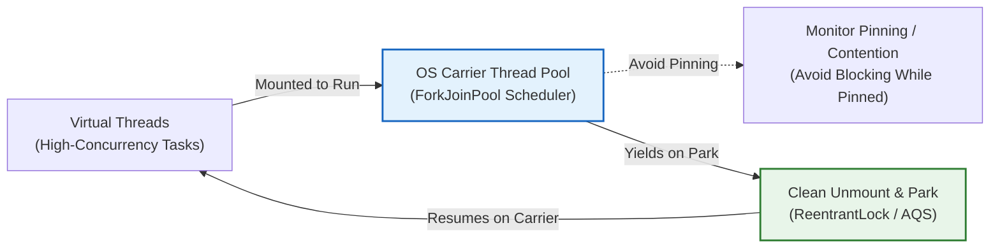

# 06: Virtual Threads Internals & Carrier Scheduling

## Architectural Overview

Project Loom virtual threads make high-concurrency I/O programming straightforward, but their throughput depends on letting carrier threads unmount cleanly during blocking operations:

- **Carrier Pinning & Blocking Anti-Pattern:** Holding a `synchronized` monitor across blocking I/O or saturating shared pools without AQS/lock awareness can pin virtual threads to OS carrier threads and reduce scalability.
- **Carrier Unmounting & AQS/Lock Awareness:** Uses virtual-thread-friendly synchronization (`ReentrantLock` / AQS) and non-pinning patterns so carrier threads are released promptly while waiting threads park cleanly.



---

## Key Trade-offs

| Dimension | Platform Threads / Blocking `synchronized` | Virtual Threads + Unmount-Safe Locks (`ReentrantLock`/AQS) |
| :--- | :--- | :--- |
| **I/O Concurrency Scaling** | Bounded by scarce OS thread stacks & pools | Scales to large numbers of concurrent blocking I/O tasks |
| **Pinning & Contention Risk** | Thread blocks OS thread directly | Must avoid carrier pinning to preserve scheduler throughput |
| **CPU-Bound Work** | Matches available CPU cores | Still bounded by physical CPU cores; no magic speedup for pure CPU math |

---

## Build & Run

```bash
mvn test -f 01-java-internals-mastery/06-virtual-threads-internals/pom.xml -Dnet.bytebuddy.experimental=true
```
