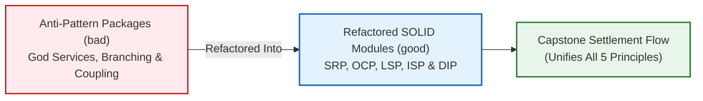

# 07: SOLID Design Principles in Enterprise Java

## Architectural Overview

Enterprise Java codebases accumulate coupling when business orchestration, branching rules, subtyping contracts, and infrastructure adapters are mixed together:

- **God-Service & Tightly Coupled Anti-Pattern (`bad`):** Monolithic services, cascading type branches, broken substitutability, fat interfaces, and direct infrastructure calls make code brittle and hard to test.
- **Modular SOLID Refactoring (`good`):** Separates responsibilities (SRP), routes via extensible strategies (OCP), preserves behavioral contracts (LSP), narrows role interfaces (ISP), and isolates infrastructure behind ports/adapters (DIP) through to a unified capstone workflow.



---

## Key Trade-offs

| Dimension | Procedural / Coupled Design (`bad`) | SOLID + Hexagonal Ports (`good`) |
| :--- | :--- | :--- |
| **Change Isolation & Extensibility** | Changes ripple across unrelated logic & conditionals | Focused collaborators & strategy extension points localize change |
| **Testability** | Requires heavy wiring or hits real infrastructure | Easy unit & contract testing via ports and small components |
| **Upfront Structure** | Fast initial script/class | More interfaces, small classes & explicit contracts to navigate |

---

## Build & Run

```bash
mvn test -f 01-java-internals-mastery/07-solid-design-principles/pom.xml -Dnet.bytebuddy.experimental=true
```
