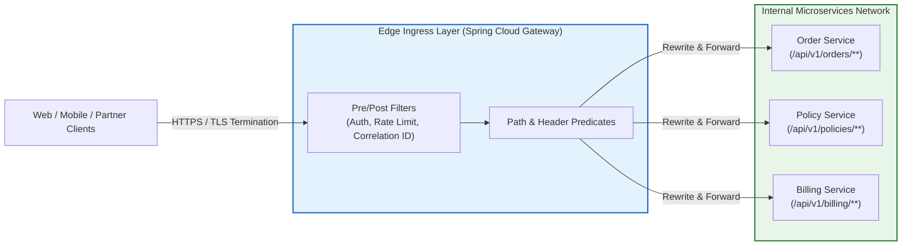

# 01: API Gateway Pattern (Ingress Routing & Edge Security)

## Architectural Overview

Exposing dozens of internal microservices directly to external Web, Mobile, and partner clients creates tight coupling, fragmented authentication, and cross-cutting operational sprawl:

- **Direct Client-to-Service Anti-Pattern:** Clients must track internal service hosts/ports, handle protocol translation, and absorb internal refactoring directly.
- **Edge Gateway Solution:** A single reverse-proxy ingress boundary terminates TLS, validates JWT/API tokens, enforces rate limits, injects correlation headers, and routes requests via path predicates to downstream services.



---

## Key Trade-offs

| Dimension | Direct Client-to-Microservice | API Gateway Ingress Pattern |
| :--- | :--- | :--- |
| **Attack Surface** | Every microservice exposed publicly | Single hardened perimeter boundary |
| **Cross-Cutting Concerns** | Duplicated auth/CORS/rate-limit filters per service | Centralized once at the edge gateway |
| **Latency & Hops** | Zero proxy overhead | Adds sub-millisecond reactive Netty hop |
| **Failure Blast Radius** | Isolated per endpoint | Gateway misconfiguration or overload affects all routes |

---

## Production Verification Tests Included
- [`ApiGatewayRoutingIntegrationTest.java`](src/test/java/com/arivubuilds/microservices/gateway/ApiGatewayRoutingIntegrationTest.java): End-to-end integration test validating path predicate routing, header mutation filters, and fallback responses using WireMock / embedded web test client.

## Build & Run
```bash
mvn clean test -f 02-microservices-patterns-series/01-api-gateway-pattern/pom.xml -Dnet.bytebuddy.experimental=true
```
