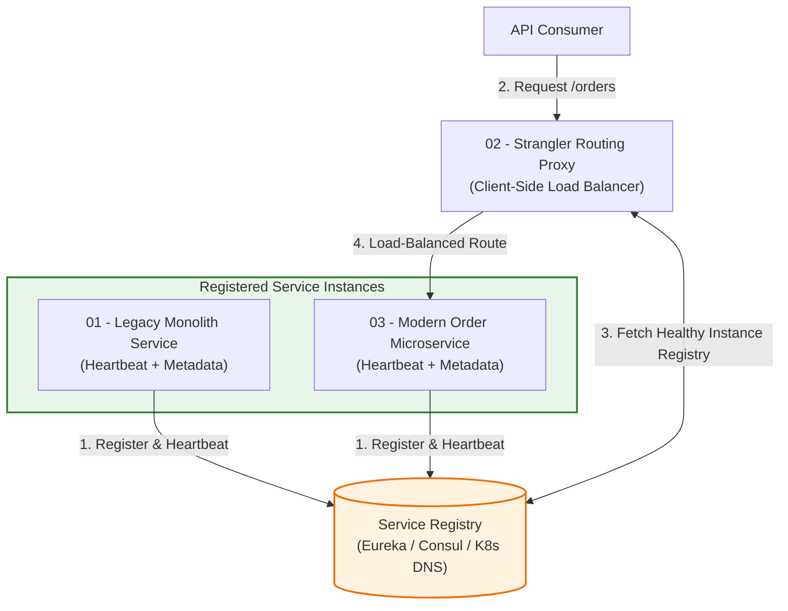

# 02: Service Discovery & Registry Pattern (Dynamic Routing)

## Architectural Overview

In cloud-native and containerized environments, microservice instances scale elastically and receive ephemeral IP addresses and ports. Hardcoding hostnames or static load-balancer IP lists breaks immediately during autoscaling or rolling deployments:

- **Dynamic Registration:** Service instances (`01-legacy-monolith-service`, `03-modern-order-service`) register their network locations and heartbeat health endpoints with a central registry upon startup.
- **Dynamic Lookup & Load-Balanced Routing:** Routing proxies (`02-strangler-routing-proxy`) resolve logical service IDs (`lb://order-service`) dynamically, automatically evicting unhealthy instances without manual config reloads.



---

## Key Trade-offs

| Dimension | Client-Side Discovery (Spring Cloud LoadBalancer) | Server-Side Discovery (AWS ALB / K8s Service) |
| :--- | :--- | :--- |
| **Network Hops** | Direct call from caller to target instance (1 hop) | Extra hop through dedicated load balancer |
| **Routing Intelligence** | Custom sticky, zone-aware, or weighted rules in JVM | Constrained to infrastructure LB capabilities |
| **Polyglot Support** | Requires discovery SDK per language | Language-agnostic (standard DNS / VIP) |
| **Registry Outage Behavior** | Continues routing using local cached registry | Depends on control-plane health checks |

---

## Production Verification Tests Included
- Multi-module reactor verification across `01-legacy-monolith-service`, `02-strangler-routing-proxy`, and `03-modern-order-service` validating service registration, health eviction, and dynamic route resolution.

## Build & Run
```bash
mvn clean test -f 02-microservices-patterns-series/02-service-discovery-registry-pattern/pom.xml -Dnet.bytebuddy.experimental=true
```
