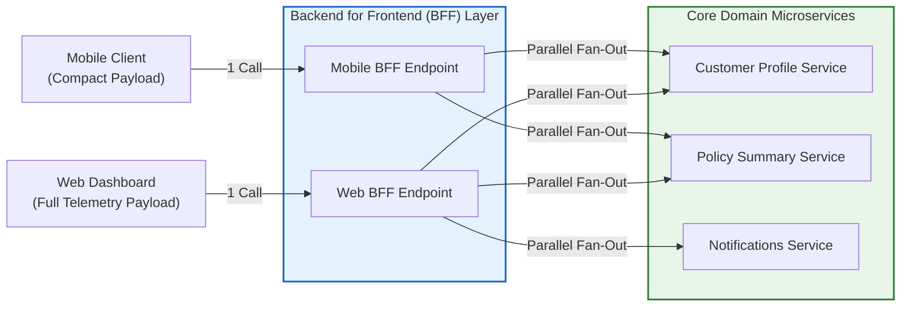

# 03: Backend for Frontend (BFF) Pattern

## Architectural Overview

A single general-purpose API forces diverse clients—rich desktop Web dashboards vs. bandwidth-constrained Mobile apps—into painful compromises:

- **Over-Fetching & Chatty Round-Trips:** Mobile clients either download megabytes of unused desktop fields or execute 5–6 sequential HTTP round-trips over high-latency cellular networks to render one screen.
- **Client-Tailored BFF Aggregation:** Dedicated BFF endpoints execute parallel non-blocking fan-out calls (`CompletableFuture` / reactive pipelines) to downstream domain services, reshaping and trimming payloads specifically for each client form factor.



---

## Key Trade-offs

| Dimension | Single One-Size-Fits-All API | Dedicated BFF Layer |
| :--- | :--- | :--- |
| **Mobile Payload & Latency** | High (chatty calls + over-fetching) | Optimal (single round-trip, lean DTOs) |
| **Frontend Autonomy** | Blocked by shared backend schema changes | UI teams iterate independently on BFF views |
| **Code Duplication Risk** | Low (single API surface) | Must keep shared domain logic in core services |
| **Partial Failure Handling** | Fails entire screen or leaks raw errors | BFF degrades non-critical widgets gracefully |

---

## Production Verification Tests Included
- [`BffAggregationIntegrationTest.java`](src/test/java/com/arivubuilds/microservices/bff/BffAggregationIntegrationTest.java): End-to-end integration test validating parallel downstream fan-out, client-specific DTO shaping, and partial fallback degradation.

## Build & Run
```bash
mvn clean test -f 02-microservices-patterns-series/03-backend-for-frontend-pattern/pom.xml -Dnet.bytebuddy.experimental=true
```
