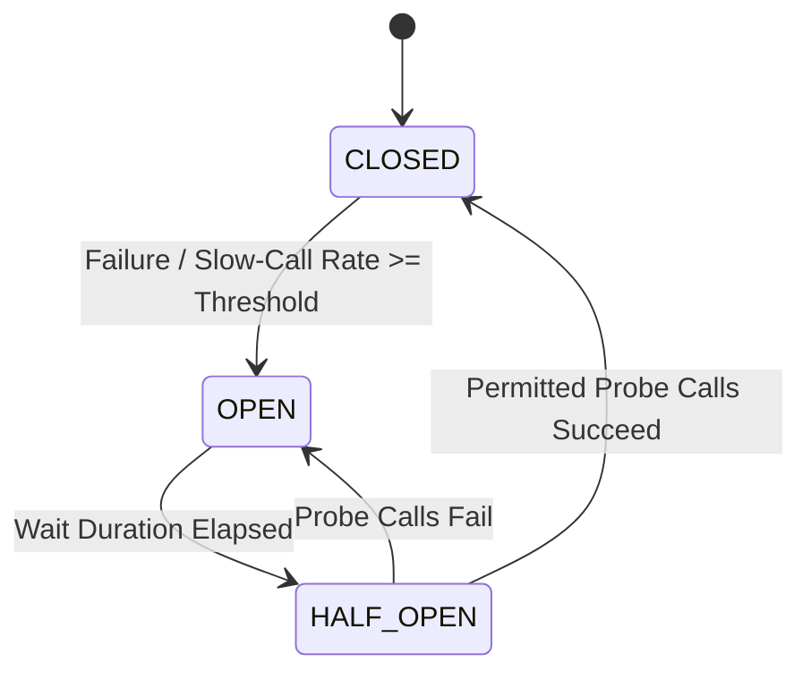

# 04: Circuit Breaker & Fallback Pattern (Resilience4j)

## Architectural Overview

When a downstream microservice stalls or throws sustained 5xx errors, synchronous callers keep waiting until connection pools and worker threads saturate—triggering cascading failures across the entire platform:

- **Fail-Fast State Machine:** A Resilience4j Circuit Breaker tracks sliding-window failure and slow-call rates, tripping from `CLOSED` to `OPEN` once thresholds breach so requests fail fast in microseconds without hitting the degraded dependency.
- **Controlled Self-Healing:** After a configured wait duration, the breaker transitions to `HALF_OPEN` and allows a limited number of probe calls through to verify recovery before closing again.



---

## Key Trade-offs

| Dimension | Unprotected Synchronous Calls | Resilience4j Circuit Breaker + Fallback |
| :--- | :--- | :--- |
| **Downstream Outage Behavior** | Threads block until socket timeout; cascades upstream | Fails fast in `< 1ms` and returns cached/degraded fallback |
| **Recovery Safety** | Sudden traffic spike crushes recovering service | `HALF_OPEN` throttles probe traffic gradually |
| **Window Strategy** | N/A | Count-based vs. Time-based sliding windows |
| **State Consistency** | Stateless | Per-instance state (must tune thresholds per replica count) |

---

## Production Verification Tests Included
- [`CircuitBreakerResilienceIntegrationTest.java`](src/test/java/com/arivubuilds/microservices/circuitbreaker/CircuitBreakerResilienceIntegrationTest.java): Integration test verifying `CLOSED -> OPEN -> HALF_OPEN -> CLOSED` state transitions and deterministic fallback execution.

## Build & Run
```bash
mvn clean test -f 02-microservices-patterns-series/04-circuit-breaker-pattern/pom.xml -Dnet.bytebuddy.experimental=true
```
