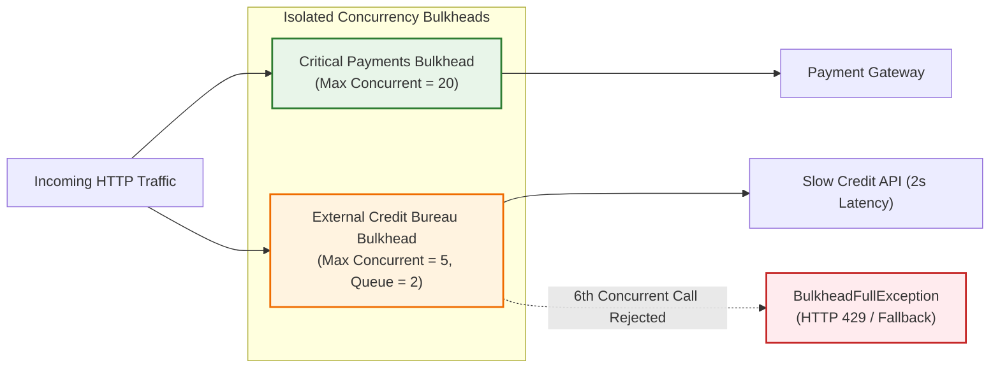

# 05: Bulkhead Isolation Pattern (Concurrency Compartmentalization)

## Architectural Overview

Inspired by watertight ship hull compartments, the Bulkhead Pattern prevents a single slow or misbehaving downstream integration from exhausting shared JVM thread pools or connection resources:

- **Shared Pool Starvation Anti-Pattern:** When all endpoints share one Tomcat/Jetty worker pool, a slow third-party underwriting or analytics service consumes every thread, starving fast health checks and critical checkout endpoints.
- **Compartmentalized Quotas:** Each downstream dependency receives a strictly bounded concurrency quota via **Semaphore Bulkheads** (in-thread concurrency cap) or **Fixed Thread-Pool Bulkheads** (dedicated queue + worker pool).



---

## Key Trade-offs

| Dimension | Semaphore Bulkhead | Thread-Pool Bulkhead |
| :--- | :--- | :--- |
| **Execution Thread** | Runs on caller thread (zero context-switch overhead) | Offloads to dedicated bounded worker pool + queue |
| **Timeout Enforcement** | Relies on underlying non-blocking/socket timeout | Supports true async `TimeLimiter` cancellation |
| **Memory & CPU Overhead** | Minimal (atomic permit counter) | Higher (extra thread stack memory + context switching) |
| **Best Fit** | Reactive/Virtual-Thread apps & low-latency calls | Legacy blocking I/O & untrusted third-party APIs |

---

## Production Verification Tests Included
- [`BulkheadIsolationIntegrationTest.java`](src/test/java/com/arivubuilds/microservices/bulkhead/BulkheadIsolationIntegrationTest.java): Concurrent load test verifying that saturating the slow dependency bulkhead rejects excess calls immediately while leaving critical endpoints unaffected.

## Build & Run
```bash
mvn clean test -f 02-microservices-patterns-series/05-bulkhead-isolation-pattern/pom.xml -Dnet.bytebuddy.experimental=true
```
