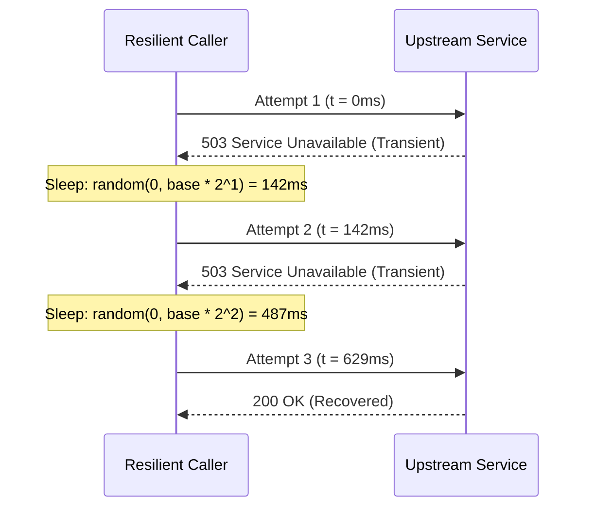

# 06: Retry & Exponential Backoff Pattern (Decorrelated Jitter)

## Architectural Overview

Transient network blips, brief leader elections, and temporary `503 Service Unavailable` spikes are normal in distributed systems—but naive immediate retries turn brief hiccups into self-inflicted DDoS attacks:

- **Thundering-Herd Retry Storm:** If 5,000 clients fail simultaneously and retry at exact fixed intervals (`1s, 2s, 4s`), synchronized retry waves repeatedly crush the recovering service.
- **Exponential Backoff + Decorrelated Jitter:** Multiplying delay exponentially ($base \times 2^{attempt}$) and randomizing the sleep interval spreads retry arrivals evenly across time, while strictly filtering retries to idempotent operations and transient error codes.



---

## Key Trade-offs

| Dimension | Fixed-Interval Retries | Exponential Backoff + Full/Decorrelated Jitter |
| :--- | :--- | :--- |
| **Cluster Contention** | High (synchronized retry spikes) | Minimal (randomized arrival distribution) |
| **Non-Transient Errors (`400`, `401`)** | Must never retry (wastes budget) | Aborts immediately via `retryOnException` predicate |
| **Mutation Safety** | Risk of duplicate charges/orders | Paired with `Idempotency-Key` headers on writes |
| **End-to-End SLA Budget** | Unbounded retries breach upstream timeouts | Capped via `maxAttempts` + overall deadline budget |

---

## Production Verification Tests Included
- [`RetryExponentialBackoffTest.java`](src/test/java/com/arivubuilds/microservices/retry/RetryExponentialBackoffTest.java): Unit and integration tests verifying exponential backoff bounds, jitter variance, transient recovery, and immediate abort on non-retryable `4xx` responses.

## Build & Run
```bash
mvn clean test -f 02-microservices-patterns-series/06-retry-exponential-backoff-pattern/pom.xml -Dnet.bytebuddy.experimental=true
```
