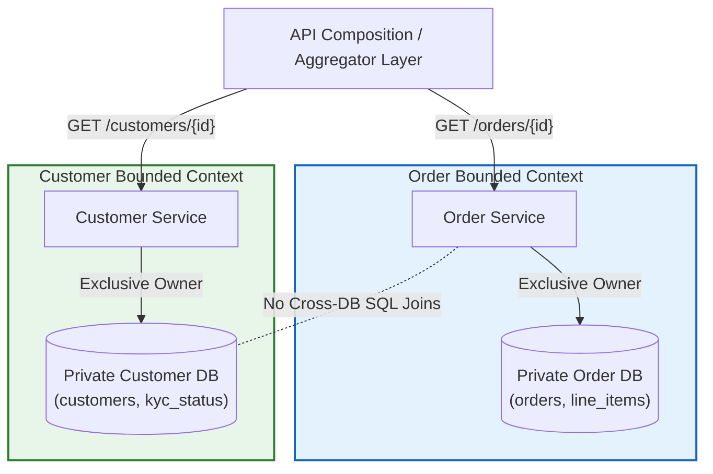

# 07: Database-per-Service Pattern (Bounded-Context Isolation)

## Architectural Overview

Sharing a single monolithic relational database across multiple microservices creates invisible schema coupling—turning independent services into a distributed monolith:

- **Shared-Database Anti-Pattern:** Cross-service `JOIN` queries and shared tables mean a column rename or index migration in one service breaks unrelated teams at compile time or runtime.
- **Private Bounded-Context Persistence:** Each microservice owns its private schema/datastore exclusively (`Order` store vs. `Customer` store). Cross-domain reads are resolved via explicit service APIs (API Composition) or asynchronous event projections rather than SQL joins.



---

## Key Trade-offs

| Dimension | Shared Monolithic Database | Database-per-Service Pattern |
| :--- | :--- | :--- |
| **Deployment Independence** | Tightly coupled via shared tables & foreign keys | Autonomous schema evolution & polyglot storage choice |
| **Cross-Domain Queries** | Single SQL `JOIN` | API Composition or CQRS materialized views |
| **Distributed Transactions** | Local ACID `BEGIN ... COMMIT` | Eventual consistency via Transactional Outbox & Sagas |
| **Fault & Connection Isolation** | Heavy query in one domain starves all pools | Dedicated connection pools & independent scaling |

---

## Production Verification Tests Included
- [`DatabasePerServiceIntegrationTest.java`](src/test/java/com/arivubuilds/microservices/dbperservice/DatabasePerServiceIntegrationTest.java): Integration test verifying strict schema boundary isolation and API-driven cross-context data composition.

## Build & Run
```bash
mvn clean test -f 02-microservices-patterns-series/07-database-per-service-pattern/pom.xml -Dnet.bytebuddy.experimental=true
```
