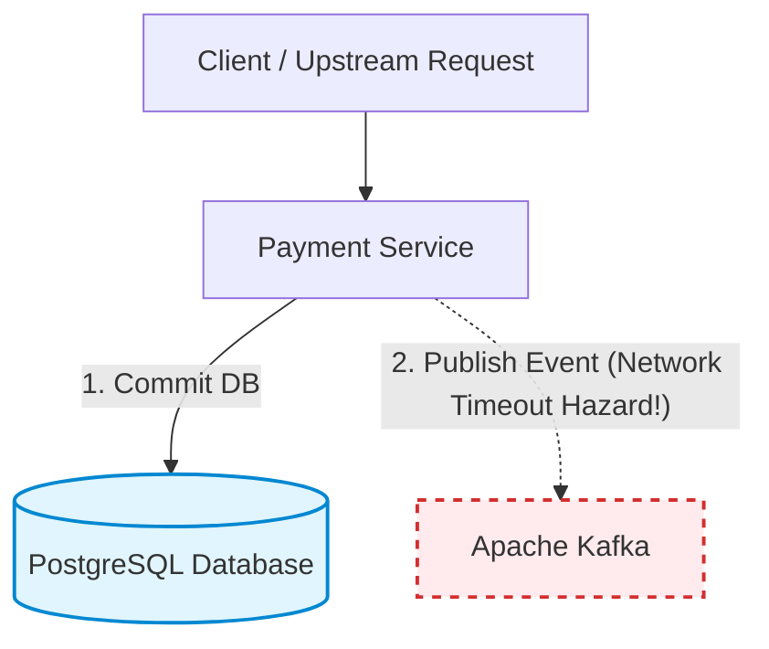
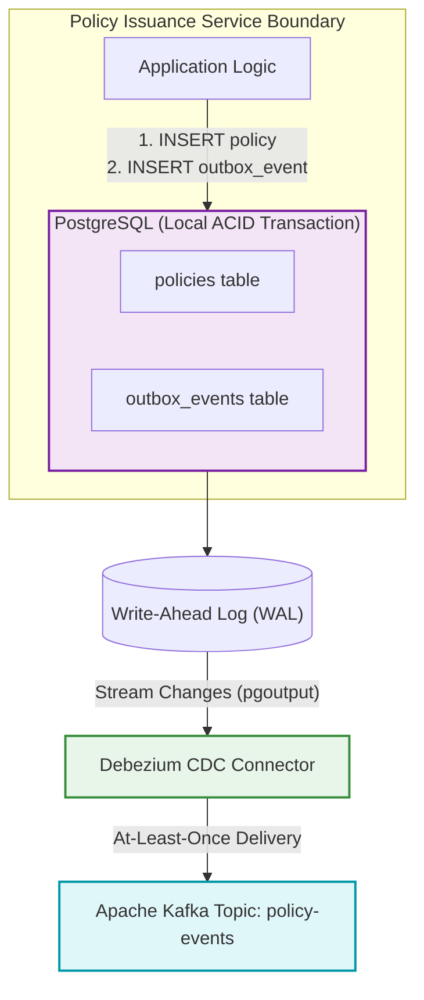

# 09: Event-Driven Architecture & The Transactional Outbox Pattern

## Architectural Overview

In a distributed microservice topology, executing a local database update and publishing an event to a message broker (e.g., Apache Kafka) represents the classical **dual-write problem**:

If the database commit succeeds but the network connection to Kafka drops, the message is lost forever (data inconsistency). If the event is published first and the database transaction rolls back, downstream systems process phantom records.

Two-Phase Commit (2PC / XA) is unfeasible across modern distributed infrastructure due to blocking locks and poor horizontal scalability.

---

## The Solution: Transactional Outbox with Change Data Capture (CDC)

Instead of reaching out across the network to Kafka during the HTTP transaction:
1. The service inserts the business record (`policies`) and the domain event (`outbox_events`) inside the **exact same ACID local transaction**.
2. A Transaction Log Miner (e.g., **Debezium CDC via PostgreSQL Write-Ahead Log / `pgoutput`**) streams new rows out of `outbox_events` asynchronously and emits them into Kafka with **at-least-once delivery guarantees**.

---

## Trade-offs & Production Considerations

| Design Concern | Trade-off / Resolution |
| :--- | :--- |
| **Dual-Write Hazard** | Eliminated entirely; RDBMS atomicity enforces consistency. |
| **CDC vs. Poller** | Log tailing (Debezium) avoids polling CPU overhead and polling query locks. |
| **Delivery Semantics** | Guarantees **at-least-once**. Downstream consumers must be idempotent (using deduplication keys). |
| **Outbox Compaction** | Tabled rows must be vacuumed/truncated asynchronously to prevent unbounded RDBMS table bloat. |

---

## Production Implementations Included
- [`V1__create_outbox_schema.sql`](src/main/resources/db/migration/V1__create_outbox_schema.sql): PostgreSQL DDL defining business aggregate and outbox event tables with CDC indexing.
- [`PolicyIssuanceService.java`](src/main/java/com/arivubuilds/microservices/outbox/service/PolicyIssuanceService.java): Production transactional service writing domain aggregates and outbox payloads atomically.
- [`TransactionalOutboxTest.java`](src/test/java/com/arivubuilds/microservices/outbox/TransactionalOutboxTest.java): Concurrency and rollback test verifying zero partial state writes under failure conditions.
