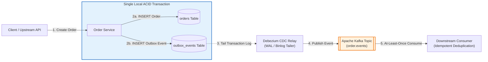

# 09: Transactional Outbox & CDC Pattern (Dual-Write Elimination)

## Architectural Overview

In event-driven microservices, updating a local database and publishing a domain event to Apache Kafka inside the same request introduces the **Dual-Write Anti-Pattern**:

- **Dual-Write Failure Modes:** If the database commits but the Kafka broker times out (or the JVM crashes right before `kafkaTemplate.send()`), downstream consumers permanently miss the state transition. Conversely, publishing to Kafka before the DB commits leaks phantom events if the local transaction rolls back.
- **Transactional Outbox + Log-Based CDC:** The service writes both the business entity (`orders`) and an immutable event record (`outbox_events`) inside the **exact same local ACID transaction**. A Change Data Capture (CDC) connector (Debezium tailing the DB WAL/Binlog) asynchronously streams committed outbox rows to Kafka with at-least-once delivery guarantees.



---

## Key Trade-offs

| Dimension | Direct Dual-Write (`DB + Kafka`) | Polling Publisher Outbox | Log-Based CDC Outbox (Debezium) |
| :--- | :--- | :--- | :--- |
| **Atomicity Guarantee** | None (prone to lost or phantom events) | Atomic via local ACID DB commit | Atomic via local ACID DB commit |
| **Database Load** | Low | High (`SELECT ... FOR UPDATE` polling contention) | Minimal (tails sequential WAL / Binlog) |
| **Delivery Semantics** | Best-effort (data loss risk) | At-least-once | At-least-once (requires idempotent consumers) |
| **Operational Footprint** | Zero extra infra | Simple scheduled worker in app | Requires Kafka Connect / Debezium connector |

---

## Production Verification Tests Included
- [`TransactionalOutboxIntegrationTest.java`](src/test/java/com/arivubuilds/microservices/outbox/TransactionalOutboxIntegrationTest.java): Integration test validating atomic persistence of domain state and outbox entries within a single transaction boundary, rollback consistency, and relay publication semantics.

## Build & Run
```bash
mvn clean test -f 02-microservices-patterns-series/09-transactional-outbox-pattern/pom.xml -Dnet.bytebuddy.experimental=true
```
