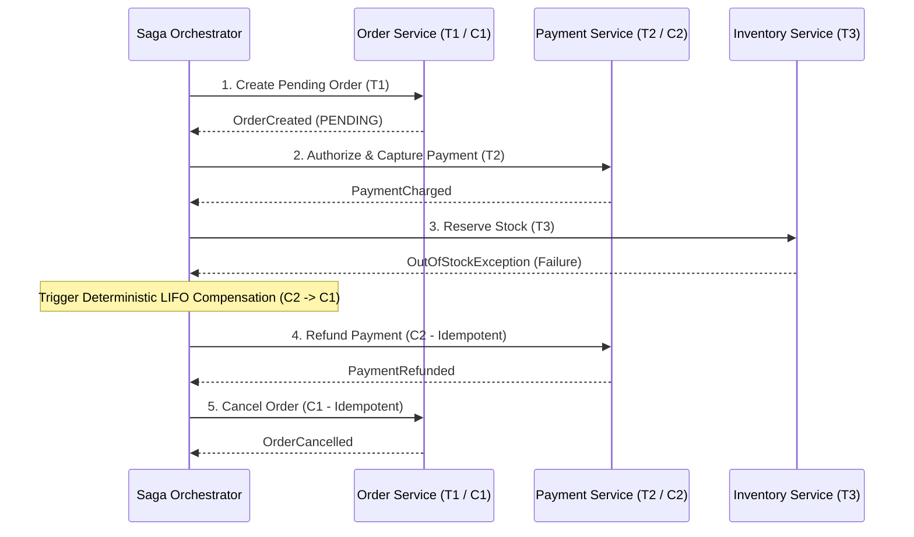

# 10: Saga Orchestration Pattern (Deterministic LIFO Compensation)

## Architectural Overview

In a Database-per-Service architecture, distributed Two-Phase Commit (2PC / XA) transactions hold long-lived database row locks across network boundaries—collapsing throughput and violating service autonomy:

- **Sequence of Local ACID Transactions:** A Saga breaks a cross-service business workflow ($T_1 \rightarrow T_2 \rightarrow T_3$) into independent local transactions executed by participating services.
- **Centralized State Machine & LIFO Rollback:** A durable Saga Orchestrator tracks step transitions (`StepState`) and sends explicit commands. If step $T_3$ fails (e.g., Inventory out of stock), the orchestrator deterministically executes idempotent **Compensating Transactions** in reverse LIFO order ($C_2 \rightarrow C_1$) to semantically undo prior commits.



---

## Key Trade-offs

| Dimension | Saga Choreography (Event-Driven) | Saga Orchestration (Command-Driven) |
| :--- | :--- | :--- |
| **Workflow Visibility** | Fragmented across event subscribers | Single source of truth in Orchestrator state log |
| **Service Coupling** | Zero central controller, but prone to cyclic event webs | Orchestrator knows participant commands; participants stay decoupled |
| **Failure Recovery & Retries** | Hard to coordinate multi-step backward rollbacks | Deterministic LIFO compensation with crash recovery |
| **Best Fit** | Simple 2–3 step linear workflows | Complex multi-step enterprise workflows (Checkout, Underwriting) |

---

## Production Verification Tests Included
- [`SagaOrchestrationIntegrationTest.java`](src/test/java/com/arivubuilds/microservices/saga/SagaOrchestrationIntegrationTest.java): Integration test validating happy-path forward execution ($T_1 \rightarrow T_2 \rightarrow T_3$) and deterministic LIFO compensating rollbacks ($C_2 \rightarrow C_1$) upon downstream failure.

## Build & Run
```bash
mvn clean test -f 02-microservices-patterns-series/10-saga-orchestration-pattern/pom.xml -Dnet.bytebuddy.experimental=true
```
