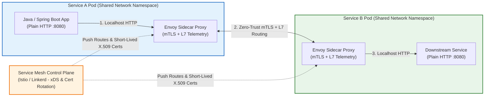

# 11: Sidecar & Service Mesh Pattern (Envoy L7 Proxy & mTLS)

## Architectural Overview

In polyglot microservice fleets spanning Java, Go, Python, and Node.js, embedding cross-cutting network libraries—mutual TLS (mTLS), distributed tracing, retries, and metrics—inside every application codebase creates severe operational drift:

- **Library-Heavy Anti-Pattern:** Upgrading TLS cipher suites, rotating X.509 certificates, or tuning retry policies requires modifying, rebuilding, and redeploying dozens of heterogeneous repositories.
- **Sidecar Proxy + Service Mesh Control Plane:** An auxiliary Envoy proxy runs alongside the application container inside the same network namespace (`localhost`). Application code speaks plain HTTP locally while Envoy transparently intercepts inbound/outbound traffic to enforce zero-trust mTLS, L7 traffic shaping, and OpenTelemetry telemetry.



---

## Key Trade-offs

| Dimension | Embedded App SDKs (Resilience4j / Micrometer) | Sidecar Proxy + Service Mesh (Envoy / Istio) |
| :--- | :--- | :--- |
| **Polyglot Consistency** | Duplicated per language & framework version | Uniform L7 policy enforcement across all languages |
| **Zero-Trust mTLS & Cert Rotation** | Manual keystore/truststore management per JVM | Automated SPIFFE identity & short-lived cert rotation |
| **Latency & Resource Footprint** | Zero extra proxy hop or sidecar memory | Adds ~1–2ms proxy hop + Envoy RAM/CPU per Pod |
| **App Responsibility** | App handles retries, TLS, and metrics directly | App only propagates W3C `traceparent` / `b3` headers |

---

## Production Verification & Artifacts Included
- Envoy L7 listener/cluster routing configurations, local mTLS certificate generation scripts, and multi-container sidecar specs under `02-microservices-patterns-series/11-sidecar-service-mesh-pattern/`.

## Build & Run
```bash
mvn clean test -f 02-microservices-patterns-series/11-sidecar-service-mesh-pattern/pom.xml -Dnet.bytebuddy.experimental=true
```
