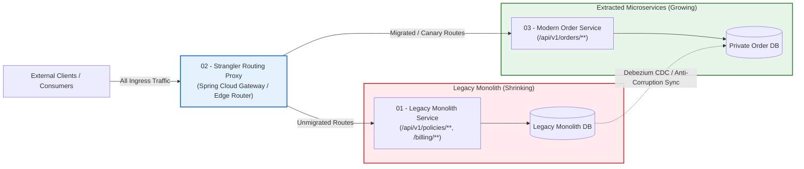

# 12: Strangler Fig Pattern (Incremental Zero-Downtime Monolith Migration)

## Architectural Overview

Attempting a Big Bang rewrite of a mission-critical legacy monolith carries catastrophic delivery risk—requirements drift while two systems evolve in parallel, and overnight cutovers trigger severe production regressions:

- **Big Bang Rewrite Anti-Pattern:** Freezing business features for 12–18 months while building a greenfield replacement leads to missed deadlines, schema divergence, and high-stress weekend cutovers.
- **Incremental Edge Strangling:** Inspired by Australian strangler fig vines that gradually envelop a host tree, an edge routing proxy (`02-strangler-routing-proxy`) intercepts all inbound traffic in front of the legacy monolith (`01-legacy-monolith-service`). High-value bounded contexts are carved out iteratively into independent microservices (`03-modern-order-service`), shifting traffic route-by-route via canary weights and CDC data synchronization until the monolith safely shrinks to zero.



---

## Key Trade-offs

| Dimension | Big Bang Rewrite | Strangler Fig Incremental Migration |
| :--- | :--- | :--- |
| **Delivery & Cutover Risk** | All-or-nothing overnight switchover | Incremental route-by-route canary rollout with instant rollback |
| **Time to Business Value** | Months or years before first production release | Continuous production delivery after every carved slice |
| **Data Synchronization** | Complex one-time offline schema migration | Requires temporary CDC sync & Anti-Corruption Layer (ACL) |
| **Operational Overhead** | Dual-team feature freeze & merge conflicts | Temporary dual-stack routing & observability across old/new |

---

## Production Verification Tests Included
- Multi-module reactor verification across `01-legacy-monolith-service`, `02-strangler-routing-proxy`, and `03-modern-order-service` validating edge path interception, incremental route cutover, and backward-compatible monolith fallback.

## Build & Run
```bash
mvn clean test -f 02-microservices-patterns-series/12-strangler-fig-pattern/pom.xml -Dnet.bytebuddy.experimental=true
```
