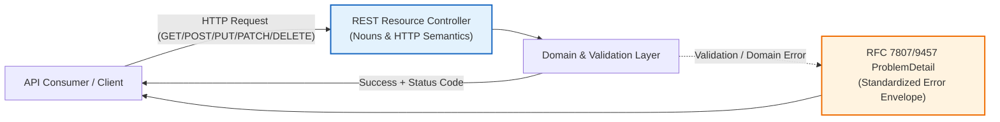

# Day 01: RESTful Resource Modeling

## Architectural Overview

Well-structured REST APIs model domain entities as nouns rather than RPC verbs, use standard HTTP methods and status codes consistently, and report errors in a predictable machine-readable structure:

- **Ad-Hoc Error & Verb-URI Anti-Pattern:** Exposing `/getOrder`, `/createPayment`, or returning inconsistent ad-hoc JSON error bodies forces clients into brittle custom parsing and breaks HTTP caching and uniform interface semantics.
- **Resource-Oriented REST with RFC 7807/9457 `ProblemDetail`:** Models canonical resource collections and sub-resources with proper HTTP status semantics (`200`, `201`, `204`, `400`, `404`, `409`, `422`) and standardized `ProblemDetail` error payloads.



---

## Key Trade-offs

| Dimension | RPC-Style / Ad-Hoc REST | Resource-Oriented REST + `ProblemDetail` |
| :--- | :--- | :--- |
| **Client Ergonomics** | Endpoint proliferation & custom error shapes | Predictable resource URIs & uniform `ProblemDetail` errors |
| **HTTP Semantics & Caching** | Inconsistent status codes & cacheability | Leverages HTTP status codes, headers & idempotent verbs |
| **Complex Mutations / Queries** | Awkward multi-resource or graph queries | Better paired with GraphQL, gRPC, or Saga workflows |

---

## Build & Run
```bash
mvn test -f 03-api-architecture-series/01-rest-resource-modeling/pom.xml -Dnet.bytebuddy.experimental=true
```
