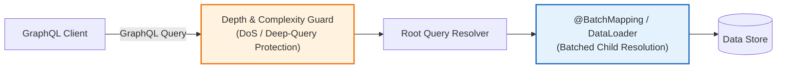

# Day 02: GraphQL Query Complexity

## Architectural Overview

GraphQL lets clients request exact nested graphs in a single round-trip, which makes unguarded queries vulnerable to deeply nested traversal attacks and database `N+1` query amplification:

- **Unguarded Graph Traversal Anti-Pattern:** Allowing arbitrary query depth, wide field selection, or per-parent resolver queries causes `N+1` database round-trips and lets a single expensive query exhaust server CPU or connection pools.
- **Query Depth/Complexity Limits + `@BatchMapping`:** Enforces query depth/complexity guardrails before execution and batches child associations via Spring GraphQL `@BatchMapping` / `DataLoader` to eliminate `N+1` lookups.



---

## Key Trade-offs

| Dimension | Unbounded GraphQL Resolvers | Depth/Complexity Guard + `@BatchMapping` |
| :--- | :--- | :--- |
| **DoS & Query Abuse Resistance** | Vulnerable to deep/wide query amplification | Rejects or bounds overly complex/deep queries early |
| **Data Fetching Efficiency** | Suffers from `N+1` queries on nested fields | Batches child lookups into grouped queries |
| **Operational Overhead** | Minimal initial setup | Requires tuning depth/complexity budgets & batch keys |

---

## Build & Run
```bash
mvn test -f 03-api-architecture-series/02-graphql-query-complexity/pom.xml -Dnet.bytebuddy.experimental=true
```
