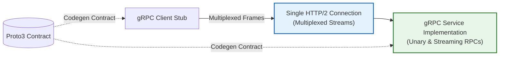

# Day 03: gRPC & Protobuf Multiplexing

## Architectural Overview

High-throughput internal service-to-service communication benefits from strongly typed Protobuf schemas and HTTP/2 connection multiplexing rather than verbose text payloads over separate connections:

- **Text-Over-HTTP/1.1 Anti-Pattern:** Repeated JSON serialization/parsing and connection-per-request overhead add latency and CPU cost across chatty internal microservices.
- **gRPC + Protobuf over HTTP/2:** Uses binary Protobuf framing, strict `.proto` contracts, concurrent stream multiplexing over a single TCP connection, and unary plus streaming RPC modes.



---

## Key Trade-offs

| Dimension | JSON over REST / HTTP/1.1 | gRPC + Protobuf over HTTP/2 |
| :--- | :--- | :--- |
| **Payload & Serialization Cost** | Human-readable JSON; higher wire size & parse CPU | Compact binary Protobuf; fast serialization & multiplexing |
| **Browser & Debugging Friction** | Native browser & curl support | Requires gRPC-Web/proxy for browsers & schema tooling |
| **Contract Evolution** | Loose schema unless enforced externally | Strict `.proto` field numbering & compatibility discipline |

---

## Build & Run
```bash
mvn test -f 03-api-architecture-series/03-grpc-protobuf-multiplexing/pom.xml -Dnet.bytebuddy.experimental=true
```
