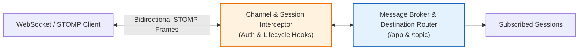

# Day 04: WebSockets STOMP Messaging

## Architectural Overview

Interactive dashboards, live notifications, and collaborative workflows need low-latency bidirectional messaging once a connection is established rather than repeated polling:

- **Polling / Ad-Hoc Socket Anti-Pattern:** Frequent HTTP polling wastes bandwidth and adds delay, while raw unstructured sockets make topic routing, authentication, and session tracking harder to maintain.
- **WebSockets with STOMP & Session Interceptors:** Upgrades HTTP to a persistent full-duplex WebSocket channel and layers STOMP frames, destination routing, and channel/session interceptors for auth and lifecycle control.



---

## Key Trade-offs

| Dimension | HTTP Polling / Request-Response | WebSockets + STOMP Messaging |
| :--- | :--- | :--- |
| **Real-Time Push Latency** | Bounded by poll interval | Immediate server-to-client & bidirectional push |
| **Connection & Session State** | Stateless per request | Stateful long-lived connections; needs scale-out broker |
| **Routing & Framing** | Standard HTTP headers/methods | STOMP destinations (`/app`, `/topic`) & frame lifecycle |

---

## Build & Run
```bash
mvn test -f 03-api-architecture-series/04-websocket-bidirectional-events/pom.xml -Dnet.bytebuddy.experimental=true
```
