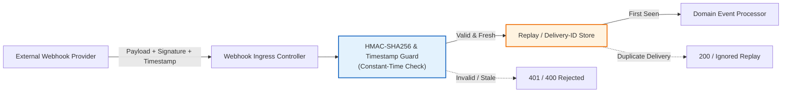

# Day 05: Webhooks HMAC Security

## Architectural Overview

Inbound webhook endpoints receive asynchronous event callbacks over the public internet, where unauthenticated or replayable payloads can trigger unauthorized side effects:

- **Unverified / Naive Webhook Receiver Anti-Pattern:** Accepting webhook POST payloads without cryptographic signature verification, constant-time comparison, or timestamp/replay checks allows forged callbacks and replay attacks.
- **HMAC-SHA256 Verification + Replay & Timing Defense:** Validates the HMAC-SHA256 signature using constant-time comparison, enforces timestamp tolerance windows, and tracks seen event/delivery IDs to reject replays.



---

## Key Trade-offs

| Dimension | Unverified Webhook Endpoint | HMAC-SHA256 + Timestamp & Replay Guard |
| :--- | :--- | :--- |
| **Authenticity & Integrity** | Vulnerable to spoofed or tampered payloads | Cryptographically proves sender & payload integrity |
| **Replay & Timing Attacks** | Susceptible to replayed events & side-channel leaks | Rejects stale timestamps, duplicates & timing leaks |
| **Operational Setup** | Zero key/state management | Requires secret rotation & replay/idempotency tracking |

---

## Build & Run
```bash
mvn test -f 03-api-architecture-series/05-webhooks-hmac-verification/pom.xml -Dnet.bytebuddy.experimental=true
```
