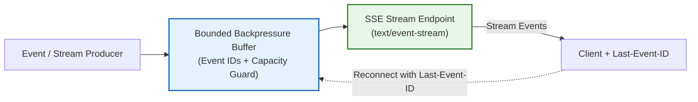

# Day 06: Server-Sent Events (SSE)

## Architectural Overview

When a server needs to stream incremental progress updates, logs, or tokens over standard HTTP to web/API clients without full client-to-server duplex framing, Server-Sent Events (SSE) provides a lightweight fit:

- **Unbounded / Unbuffered Streaming Anti-Pattern:** Pushing events faster than slow clients can read without bounded buffers or `Last-Event-ID` support drops updates silently or exhausts memory.
- **SSE with Backpressure Buffer & `Last-Event-ID`:** Streams `text/event-stream` events over HTTP with bounded backpressure buffers and event IDs so reconnecting clients resume cleanly from `Last-Event-ID`.



---

## Key Trade-offs

| Dimension | Server-Sent Events (SSE) | WebSockets |
| :--- | :--- | :--- |
| **Directionality** | Server-to-client stream over standard HTTP | Full-duplex bidirectional messaging |
| **Reconnection & Resume** | Built-in browser retry & `Last-Event-ID` header | Custom reconnect & state-resync logic required |
| **Firewall / Proxy Compatibility** | Works naturally over standard HTTP/HTTPS | Can face stricter proxy/upgrade rules |

---

## Build & Run
```bash
mvn test -f 03-api-architecture-series/06-sse-unidirectional-streaming/pom.xml -Dnet.bytebuddy.experimental=true
```
