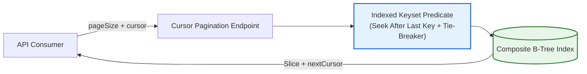

# Day 07: Keyset & Cursor Pagination

## Architectural Overview

Paginating large, rapidly changing datasets with SQL `OFFSET` degrades as page depth grows and produces duplicate or skipped items when rows are inserted or deleted concurrently:

- **High-Offset `LIMIT / OFFSET` Anti-Pattern:** Scanning and discarding thousands of skipped rows degrades latency as `offset` increases and shifts item boundaries under concurrent writes.
- **Keyset / Cursor Pagination (`O(1)` Seek):** Seeks directly using indexed sort columns and a cursor token, keeping lookup cost steady (`O(1)` index seek) and stabilizing page boundaries across live inserts.



---

## Key Trade-offs

| Dimension | `LIMIT / OFFSET` Pagination | Keyset / Cursor Pagination |
| :--- | :--- | :--- |
| **Deep-Page Latency** | Degrades linearly with offset (`O(offset + limit)`) | Consistent `O(1)` index seek regardless of depth |
| **Consistency Under Writes** | Rows can shift, duplicate, or skip between pages | Deterministic ordering via cursor & tie-breaker |
| **Arbitrary Page Jumping** | Supports jumping straight to page `N` | Optimized for sequential next/prev traversal |

---

## Build & Run
```bash
mvn test -f 03-api-architecture-series/07-api-pagination-cursor-seek/pom.xml -Dnet.bytebuddy.experimental=true
```
