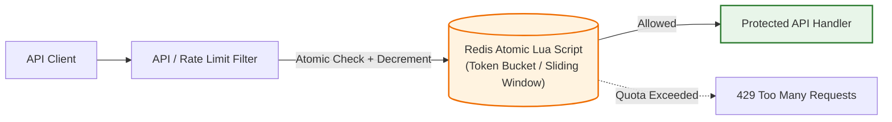

# Day 08: Distributed Rate Limiting

## Architectural Overview

Multi-instance API deployments cannot rely solely on per-node in-memory counters when enforcing fair usage, quota protection, and traffic smoothing across horizontal replicas:

- **Per-Instance / Race-Prone Counter Anti-Pattern:** Local memory counters allow `N * limit` bursts across `N` replicas, while non-atomic read-then-write checks suffer from race conditions under concurrent load.
- **Distributed Rate Limiting via Redis Lua Scripts:** Executes atomic Token Bucket or Sliding Window logic inside Redis so distributed API nodes share accurate rate decisions in a single round-trip.



---

## Key Trade-offs

| Dimension | Local In-Memory Limiter | Redis Lua Token Bucket / Sliding Window |
| :--- | :--- | :--- |
| **Cluster Accuracy** | Approximate per-instance limit (`N` replicas) | Centralized, atomic enforcement across all instances |
| **Burst Shaping** | Local only | Token bucket allows controlled bursts smoothly |
| **Dependency & Failure Mode** | Zero external network hop | Adds Redis dependency; requires fail-open/closed choice |

---

## Build & Run
```bash
mvn test -f 03-api-architecture-series/08-rate-limiting-redis-token-bucket/pom.xml -Dnet.bytebuddy.experimental=true
```
