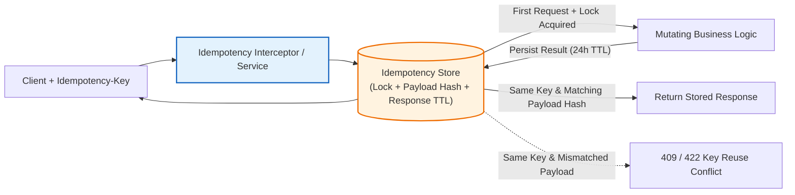

# Day 09: Idempotency Keys

## Architectural Overview

Network timeouts, mobile retries, and gateway replays mean mutating API requests (`POST` / state changes) can arrive more than once—risking duplicate charges, orders, or records:

- **Non-Idempotent Mutation Anti-Pattern:** Executing state-changing business logic on every retry without deduplication or payload verification creates duplicate side effects or silently applies a different payload under the same key.
- **Idempotency Keys with Lock, Hash & Deduplication:** Coordinates concurrent retries with a distributed lock, hashes the canonical request payload to detect key reuse conflicts, and replays cached responses within the retention window (e.g., 24 hours).



---

## Key Trade-offs

| Dimension | Unprotected Mutating Endpoints | Idempotency Key + Payload Hash + TTL Store |
| :--- | :--- | :--- |
| **Retry Safety** | Retries can duplicate side effects | Safe retries with cached response replay |
| **Misuse Detection** | Cannot distinguish retry vs. payload mismatch | Payload hash catches conflicting requests reusing a key |
| **Storage & TTL Lifecycle** | No extra state stored | Requires idempotency store capacity & TTL cleanup |

---

## Build & Run
```bash
mvn test -f 03-api-architecture-series/09-idempotency-keys-deduplication/pom.xml -Dnet.bytebuddy.experimental=true
```
