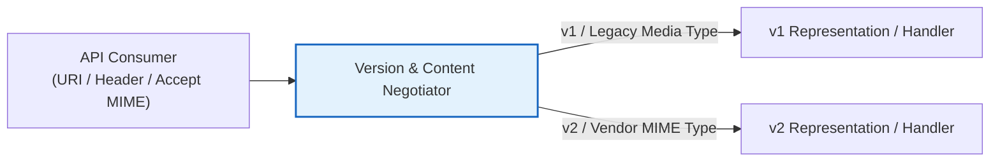

# Day 10: API Versioning Strategies

## Architectural Overview

Evolving public and partner APIs without breaking existing consumers requires deliberate versioning and representation negotiation across URI paths, headers, and media types:

- **Unversioned Breaking Changes Anti-Pattern:** Renaming fields, changing types, or altering response shapes in place breaks existing clients silently or forces abrupt lockstep upgrades.
- **API Versioning & Content Negotiation:** Supports explicit versioning and media-type negotiation (URI path versioning, custom headers, or vendor MIME types) so old and new representations coexist cleanly during migration windows.



---

## Key Trade-offs

| Dimension | URI Path Versioning (`/v1/...`) | Header / Vendor MIME Negotiation |
| :--- | :--- | :--- |
| **Discoverability & Routing** | Immediately visible in URLs, logs & proxies | Clean URLs; negotiated via headers/`Accept` MIME |
| **URL Stability** | Changes resource URI across major versions | Keeps canonical resource URI unchanged |
| **Maintenance Burden** | Multiple versioned routes/controllers to retire | Requires clear header/MIME conventions & deprecation policy |

---

## Build & Run
```bash
mvn test -f 03-api-architecture-series/10-api-versioning-content-negotiation/pom.xml -Dnet.bytebuddy.experimental=true
```
