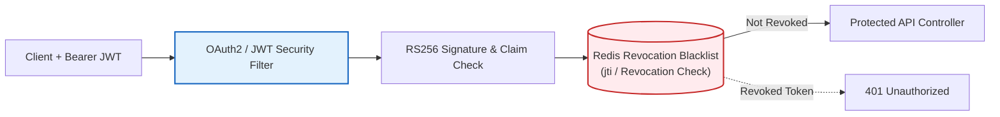

# Day 11: OAuth 2.0 & JWT Security

## Architectural Overview

Stateless JWT bearer tokens scale authentication checks across microservices without a per-request session lookup, but long-lived tokens create a revocation gap when a user logs out, rotates credentials, or is compromised:

- **Stateless-Only JWT Anti-Pattern:** Relying strictly on signature and `exp` checks until token expiry lets compromised or revoked JWTs remain valid across services after logout or incident response.
- **RS256 JWT + Fast-Path Redis Revocation Blacklist:** Verifies asymmetric RS256 signatures/claims and checks token `jti` (or user revocation epoch) against a fast Redis revocation list so compromised tokens are invalidated immediately.



---

## Key Trade-offs

| Dimension | Pure Stateless JWT Validation | RS256 JWT + Redis Revocation Blacklist |
| :--- | :--- | :--- |
| **Immediate Revocation** | Delayed until token expiration | Near-immediate revocation on logout/compromise |
| **Token Verification Speed** | Purely local signature/claim check | Local signature check + fast Redis blacklist lookup |
| **Operational Complexity** | No revocation store needed | Requires Redis availability & TTL aligned to token `exp` |

---

## Build & Run
```bash
mvn test -f 03-api-architecture-series/11-oauth2-jwt-revocation-blacklist/pom.xml -Dnet.bytebuddy.experimental=true
```
