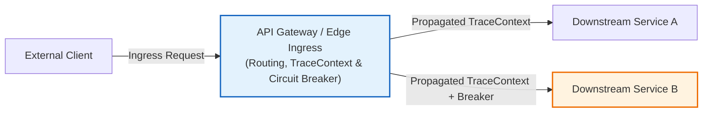

# Day 12: API Gateway & Edge Ingress

## Architectural Overview

Edge API gateways sit at the boundary between external clients and internal microservices, centralizing cross-cutting concerns while keeping downstream services focused on domain logic:

- **Direct-to-Service / Duplicated Edge Logic Anti-Pattern:** Exposing internal services directly or repeating auth, routing, tracing, and circuit-breaking logic in every microservice increases surface area and operational drift.
- **API Gateway & Edge Ingress:** Centralizes reverse-proxy routing, W3C `TraceContext` propagation across service hops, and circuit breakers at the edge to protect upstream services.



---

## Key Trade-offs

| Dimension | Direct Service Access / Per-Service Edge | Centralized API Gateway Edge Ingress |
| :--- | :--- | :--- |
| **Cross-Cutting Consistency** | Easy to drift across teams/services | Uniform routing, tracing & resilience at the edge |
| **Blast Radius & Bottlenecks** | Distributed entry points | Gateway becomes a critical edge component to size & HA-configure |
| **Payload / Protocol Translation** | Handled inside each service | Offloaded cleanly at the ingress boundary |

---

## Build & Run
```bash
mvn test -f 03-api-architecture-series/12-api-gateway-edge-ingress/pom.xml -Dnet.bytebuddy.experimental=true
```
