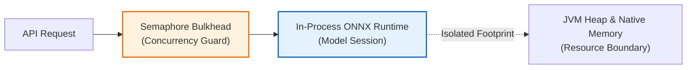

# Day 01: Monolithic AI Architectures

## Architectural Overview

Running inference in-process inside a Spring Boot service avoids network serialization and hop overhead, but shares process resources with application threads and JVM heap:

- **Unbounded In-Process Inference Anti-Pattern:** Executing heavy model inference directly on request threads without concurrency limits or memory isolation can starve HTTP workers or trigger native/heap memory pressure.
- **In-Process ONNX Runtime + Semaphore Bulkhead:** Runs ONNX Runtime inference in-process while guarding concurrency with a semaphore bulkhead and keeping JVM heap vs. native inference memory boundaries clear.



---

## Key Trade-offs

| Dimension | Embedded In-Process Inference | Out-of-Process Model Service |
| :--- | :--- | :--- |
| **Network Latency** | Zero network hop per inference call | Adds network serialization & hop latency |
| **Resource Isolation** | Shares host CPU/memory & concurrency budget with app | Scales and isolates GPU/CPU compute independently |
| **Model Lifecycle** | Tied to application deployment cycle | Models can update/scale independently |

---

## Build & Run
```bash
mvn test -f 04-ai-system-design-series/01-monolithic-ai-onnx-runtime/pom.xml -Dnet.bytebuddy.experimental=true
```
