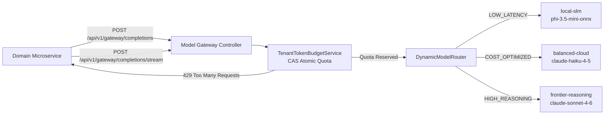

# Day 02 — Client-Server AI Model Gateway (`02-client-server-model-gateway`)

Decouples business microservices from direct LLM vendor SDK coupling by introducing a centralized **AI Model Gateway** with policy-driven provider routing, atomic per-tenant token budgeting, and unified synchronous REST + Server-Sent Events (SSE) streaming contracts.

---

## 1. Architecture Problem & Trade-offs

Embedding vendor-specific SDKs (`OpenAI`, `Anthropic`, `ONNX`, `Bedrock`) directly inside domain services creates tight coupling, scattered API keys, inconsistent retry/timeout policies, and zero visibility into per-tenant token burn.

* **Gain:** Single internal contract (`REST` + `SSE`), zero-code model swaps via `RoutingStrategy` (`COST_OPTIMIZED`, `LOW_LATENCY`, `HIGH_REASONING`), and hard pre-flight token quota enforcement (`HTTP 429`).
* **Trade-off:** Adds one network hop (`~1-3 ms` internal proxy overhead) and requires careful non-blocking SSE connection lifecycle management so slow token streams do not exhaust servlet threads.

---

## 2. Architecture Flow



---

## 3. Core Components

| Component | Responsibility |
| :--- | :--- |
| `ModelGatewayController` | Exposes unified `/completions` (JSON) and `/completions/stream` (`text/event-stream`) endpoints. |
| `DynamicModelRouter` | Resolves target `ModelProviderAdapter` via explicit override or strategy comparator (`latency` vs. `costPer1kTokens`). |
| `TenantTokenBudgetService` | Lock-free CAS token bucket (`AtomicInteger.compareAndSet`) preventing multi-threaded tenant quota overruns. |
| `ModelProviderAdapter` | SPI abstracting local edge SLMs and remote foundation models behind uniform token-chunked responses. |

---

## 4. How to Run & Verify

```bash
mvn test -f 04-ai-system-design-series/02-client-server-model-gateway/pom.xml
```
## Build & Run
```bash
mvn clean test -f 04-ai-system-design-series/02-client-server-model-gateway/pom.xml -Dnet.bytebuddy.experimental=true
```
---

## 5. Production Guardrails

* **Pre-Flight Token Reservation:** Deduct estimated prompt + max completion tokens before invoking upstream inference; reconcile actual completion tokens post-stream.
* **Bounded SSE Timeouts:** Configure explicit `SseEmitter` timeouts (`15s`-`60s`) and clean up disconnected clients on `IOException`.
* **Fallback Cascades:** Pair `HIGH_REASONING` routes with a `COST_OPTIMIZED` fallback provider when upstream latency breaches SLA thresholds.


---

**Author:** Arivumani A · [@ArivuBuilds (X)](https://x.com/ArivuBuilds) · [@ArivuBuilds (LinkedIn)](https://www.linkedin.com/in/ArivuBuilds/)
