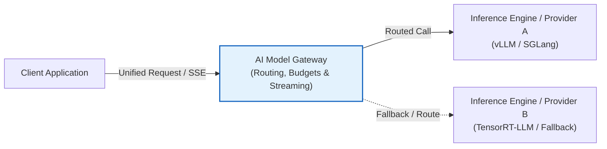

# Day 02: Client-Server and Model Gateways

## Architectural Overview

Decoupling LLM/model execution behind a dedicated gateway lets applications route across model engines or providers without hardcoding client-to-engine coupling:

- **Direct Engine / Provider Coupling Anti-Pattern:** Calling model runtimes or external providers directly from every application makes switching engines (such as vLLM, SGLang, or TensorRT-LLM) or enforcing budgets/streaming contracts inconsistent.
- **Client-Server Model Gateway:** Centralizes provider/engine routing, token/request budgets, and unified REST/SSE streaming responses behind a clean gateway boundary.



---

## Key Trade-offs

| Dimension | Direct Runtime Calls | Model Gateway Abstraction |
| :--- | :--- | :--- |
| **Provider / Engine Portability** | Coupled to specific client/runtime APIs | Isolates callers behind a unified gateway contract |
| **Latency & Hop Overhead** | Fewer intermediate hops | Adds a gateway hop; improves routing, budgeting & observability |
| **Governance & Budgets** | Scattered across services | Enforced centrally at the gateway |

---

## Build & Run
```bash
mvn test -f 04-ai-system-design-series/02-client-server-model-gateway/pom.xml -Dnet.bytebuddy.experimental=true
```
