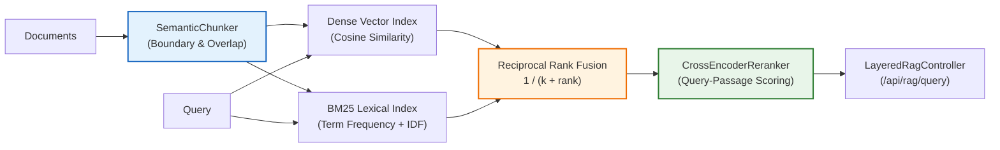

# Day 03: Layered RAG Architecture

## Architectural Overview

Production Retrieval-Augmented Generation (RAG) improves answer grounding and precision by structuring ingestion and retrieval into distinct stages rather than relying on coarse splits or single-signal lookups:

- **Single-Pass / Naive Retrieval Anti-Pattern:** Coarse or fixed character splits and dense-only similarity lookups often miss exact domain identifiers/terms or surface noisy chunks to the generator.
- **Layered RAG Architecture:** Splits documents into **semantic chunks**, runs **dense vector + BM25 lexical hybrid retrieval**, merges ranked candidates via **Reciprocal Rank Fusion (RRF)**, and refines top passages with a **Cross-Encoder reranker**.



---

## Key Trade-offs

| Dimension | Single-Pass Dense / Naive Split | Layered RAG (Semantic + Hybrid RRF + Cross-Encoder) |
| :--- | :--- | :--- |
| **Retrieval Precision & Recall** | Misses exact lexical terms or splits logical sections | Captures both exact keywords/codes and semantic meaning; reranks top hits |
| **Query Latency & Compute** | Single fast index lookup | Extra fusion and cross-encoder scoring over candidate set |
| **Pipeline Complexity** | Minimal setup | Requires chunking rules, hybrid scoring weights, RRF `k`, and rerank top-N |

---

## Build & Run
```bash
mvn test -f 04-ai-system-design-series/03-layered-rag-architecture/pom.xml -Dnet.bytebuddy.experimental=true
```
