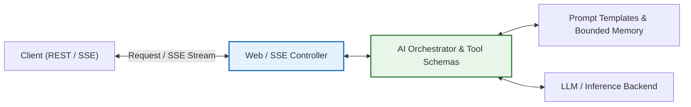

# Day 04: MVC in AI Applications

## Architectural Overview

AI-enabled web applications still benefit from clear Model-View-Controller boundaries so prompt assembly, tool/orchestrator calls, and streaming responses do not leak into controllers:

- **Fat Controller / Mixed Prompt & Stream Logic Anti-Pattern:** Embedding raw prompt strings, tool invocation rules, and stream formatting inside web controllers makes workflows hard to test and maintain.
- **Layered MVC in AI Applications:** Separates request/stream endpoints (Controller), orchestration, prompt templates, memory, and tool schemas (Service/Model), and SSE/structured response delivery.



---

## Key Trade-offs

| Dimension | Inline / Ad-Hoc AI Endpoints | Layered MVC AI Orchestration |
| :--- | :--- | :--- |
| **Testability & Separation** | Hard to unit-test prompts, tools & stream states | Clear boundaries for prompts, memory, tools & controllers |
| **Streaming Complexity** | Ad-hoc chunk writes can leak partial states | Explicit SSE lifecycle & error/completion handling |
| **Boilerplate** | Fast initial prototype | More structured interfaces & orchestration layers |

---

## Build & Run
```bash
mvn test -f 04-ai-system-design-series/04-mvc-in-ai-applications/pom.xml -Dnet.bytebuddy.experimental=true
```
